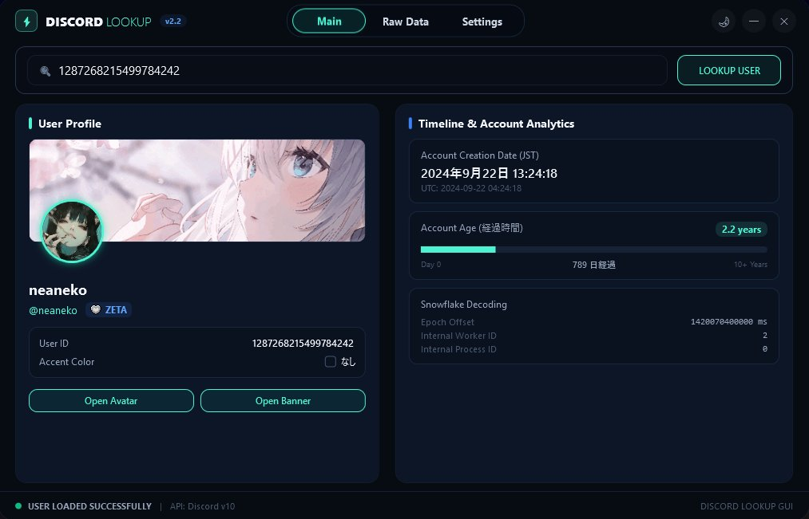

# ⚡ DISCORD LOOKUP GUI

 

**近未来サイバーパンク調の洗練された Discord ユーザー情報検索（OSINT）デスクトップクライアント**

[ダウンロード (Releases)](https://github.com/Nea623/DiscordLookupGUI/releases/latest) • [主な機能](#-主な機能) • [全6テーマ](#-全6種類のテーマ) • [使い方](#-使い方) • [更新履歴](#-v26-アップデート内容)

 

---

## ✨ 主な機能

- 🌌 **近未来・サイバーパンク UI（CYBERDECK）**
  - 発光ネオンアクセント、真円アバタークリップ、センター配置バナー、角丸ウィンドウ
  - 起動時の 1.5 秒ネオンロゴスプラッシュ演出 ＆ 優雅なフェードイン・フェードアウト
- 🏷️ **Discord 公式メンバーリスト原寸 ネームプレート (248x42px)**
  - 公式原寸 `248x42px` ＆ 角丸 8px を忠実に再現、高性能 APNG エンジンによる透過ループ再生
  - Discord 公式フォント「**gg sans**」完全埋め込み ＆ 詳細メタ情報ツールチップ
- 📊 **詳細なアカウントアナリティクス ＆ Snowflake デコード**
  - アカウント作成日時（JST / UTC）の瞬時計算、経過年数プログレスバー
  - Snowflake 詳細解析（UNIX絶対ミリ秒、Worker ID、Process ID）、インデント生 JSON タブ
- 📋 **ワンクリック・コピー機能**
  - アクセントカラー（`#xxxxxx`）、ネームプレート、Snowflake 全項目、生 JSON をワンクリックで即座にコピー
- ⚡ **クリップボード自動検索（Auto-Lookup）＆ 検索履歴**
  - メンション `<@ID>` や URL からの ID 自動抽出 ＆ クリップボード監視（ON/OFF 設定可能）
  - 検索バー横の「🕒」から直近最大 20 件を丸型アバター付きで即座に再検索
- 🔐 **トークン不要 ＆ 徹底した安全・省電力設計**
  - **共有 Bot トークン内蔵**のため設定不要ですぐに利用可能（独自トークンは Windows DPAPI で暗号化保護）
  - ウィンドウ最小化時やバックグラウンド時はアニメーションを自動停止し **CPU / GPU 負荷 0%** を維持
- 🚀 **完全単一実行ファイル（Single-File）配布**
  - ランタイム・画像・フォントをすべて内包。.NET のインストールすら不要で `DiscordLookupGUI.exe` 1つで即起動

---

## 🎨 全 6 種類のテーマ

タイトルバー右上のボタンまたは設定画面から、いつでも瞬時に切り替え可能です。設定は自動保存されます。

| アイコン | テーマ名 | 特徴・世界観 |
| :---: | :--- | :--- |
| ☀️ | **Light Theme** | 洗練されたフロストホワイト ＆ エレクトリックティールのクリーン UI |
| 🌑 | **Dark Theme** | サイバーネイビー ＆ ネオンシアンの近未来王道ダーク UI |
| 🌆 | **Sunset Theme** | トワイライトの街並み背景イラスト ＆ 情緒あふれる夕暮れオレンジ |
| 🌙 | **Lunar Dream Theme** | **【新命名】** 大きな三日月と天球儀・星座オーナメントがきらめく幻想的な月夜 |
| 🎮 | **Gaming RGB Theme** | 360°滑らかに周回回転する無限レインボーサイクル ＆ 鮮烈なネオングリーン |
| 🌠 | **Starry Night Theme** | **【新登場】** 二人が見上げる満天の紫銀河アニメーションGIF × 透き通る深紫クリスタルすりガラス |

---

## 🚀 使い方

### 1. ダウンロード ＆ 起動
[GitHub Releases](https://github.com/Nea623/DiscordLookupGUI/releases/latest) から **`DiscordLookupGUI.exe`** をダウンロードして実行します。面倒なインストールや設定は不要です。

> [!NOTE]
> **Windows SmartScreen の警告が表示された場合**  
> 「詳細情報」➔「実行」をクリックすることで安全に起動できます（完全オープンソース、個人開発のため）。

### 2. ユーザー検索
上部の検索バーに調べたいユーザーの **Discord ユーザー ID (Snowflake)**、メンション、または URL を入力して `Enter` または `LOOKUP USER` を押すだけです。

---

## ⚡ v2.6 アップデート内容

- 🌠 **新テーマ「Starry Night」の正統進化**:
  - 満天の星々がチカチカと瞬く 121 フレームのアニメーション GIF 背景を採用。
  - **透き通るクリスタルガラス（不透明度 40%）** と **ダークシェード情報枠** により、驚くほどの透明感と高い可読性を完全両立。
  - 上面から光が反射するクリスタルベベル境界線（3D 立体感）を導入。
- 🌙 **テーマ体系の整理 ＆「Lunar Dream」への改名**:
  - 三日月と星図オーナメントが特徴の旧テーマを、その世界観にふさわしい「Lunar Dream（月の夢）」へ改名。
- 🎮 **Gaming RGB の切り替え残留バグを完全解消**:
  - Gaming RGB から他テーマへ切り替えた際に、虫眼鏡アイコンの RGB 太枠や黒丸が残ってしまう問題を根絶。
- ⚡ **アニメーション省電力ライフサイクルの徹底**:
  - `Starry Night` 選択時のみ GIF デコーダーが動作し、他テーマ時や最小化時は完全停止（CPU 0%）を維持。

---

📜 <b>過去のアップデート履歴 (v2.5 / v2.4 を見る)</b>

### v2.5
- 📋 **クリップボード自動検知（Auto-Lookup）＆ 誤爆防御・設定記憶**:
  - Discord やブラウザで ID・メンション・URL をコピーした瞬間、Win32 API イベント駆動で自動検索。
- 🕒 **検索履歴（Recent Lookups）クイックドロップダウン**:
  - 検索バー横の「🕒」から直近最大 20 件を丸型アバター・表示名・ID・相対時間付きで一覧表示・再検索。
- 🔍 **メンション・URL・テキストからの ID 自動抽出**:
  - `<@ID>`, `discord.com/users/{id}` などあらゆる形式から Snowflake ID を自動抽出。
- 🟣 **公式 Discord コミュニティ（⚡DLG Community）招待ボタンの追加**
- ⚡ **Snowflake Decoding のミリ秒解析（Creation Timestamp ms）対応**
- 🎨 **バナー読み込みチラつき解消 ＆ 配布 EXE の大幅軽量化（約75MB）**

### v2.4
- 📦 **完全単一実行ファイル化（DLL不要）**: ネイティブライブラリを `.exe` 内に完全内包
- 🏷️ **Discord API v10 完全準拠 ＆ 表記同期**: `primary_guild`・公式 CDN バッジ・Snowflake 防御
- 🎨 **APNG エンジン＆描画バグ一掃**: `OVER` アルファ合成バグ根治、64MB LRU キャッシュ、STA スレッド解放
- ⚡ **省電力化 ＆ 非同期競合解消**: 最小化時・別タブ滞在時のアニメーション自動停止、キャンセルレース根絶
- 🔐 **セキュリティ強化**: カスタム Bot トークンの Windows DPAPI 暗号化保存 ＆ スレッドセーフなエラーログ

---

## 🛠️ 技術スタック

| テクノロジー | 用途 |
| :--- | :--- |
| **C# / .NET 8.0** | コアランタイム |
| **WPF (Windows Presentation Foundation)** | デスクトップ GUI & XAML スタイリング |
| **Discord API v10** | ユーザーデータ取得 REST API |
| **XamlAnimatedGif** | アニメーション GIF デコーダー & ライフサイクルレンダリング |
| **Emoji.Wpf** | DirectWrite カラー絵文字レンダリング |
| **Newtonsoft.Json** | JSON シリアライズ & インデント整形 |
| **Windows DPAPI** | カスタム Bot トークンのローカル暗号化保護 |

---

## 👤 クレジット

- **Author**: [@Nea623](https://github.com/Nea623)
- **Repository**: [DiscordLookupGUI](https://github.com/Nea623/DiscordLookupGUI)
- **Community**: [⚡DLG Community](https://discord.gg/your-invite-code)
- **License**: MIT License
